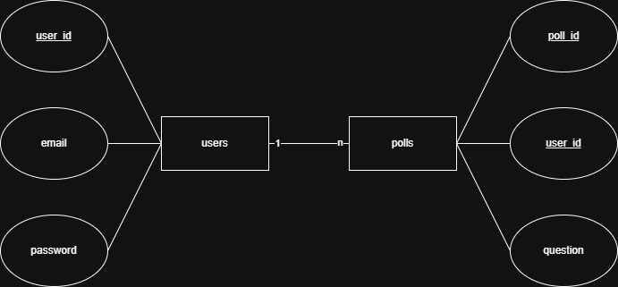

# LivePoll

**LivePoll** ist eine mehrsprachige Web-Applikation für interaktive Echtzeit-Umfragen im Unterricht und bei Präsentationen. Das Projekt entstand als Teamprojekt im Rahmen von **IPT 7.1** an der Informatikmittelschule (IMS) Luzern.

Hosts erstellen Umfragen mit Multiple-Choice- oder Freitext-Fragen und starten eine Live-Session. Teilnehmende treten ohne Registrierung über einen 6-stelligen Raumcode bei (Mobile-First) und stimmen live ab, während die Ergebnisse in Echtzeit per WebSockets aktualisiert werden.

---

## Funktionen

* **Host-Bereich (mit Login):**
  * Registrierung und Anmeldung per JWT-Authentifizierung
  * Erstellen, Bearbeiten und Speichern eigener Umfragen (Single Choice, Multiple Choice, Freitext)
  * Steuerung von Live-Sessions (Lobby, Fragenwechsel, Ergebnisansicht)
  * Archivierung abgeschlossener Sessions und Einsicht in vergangene Abstimmungsergebnisse
* **Teilnehmenden-Ansicht (ohne Login):**
  * Direkter Beitritt per 6-stelligem Raumcode auf dem Smartphone oder Laptop
  * Schutz vor Mehrfachabstimmungen pro Frage
* **Echtzeit & Mehrsprachigkeit:**
  * Live-Synchronisation von Teilnehmerzahl, aktiver Frage und Resultaten über WebSockets (STOMP / SockJS)
  * Sprachumschaltung zwischen **Deutsch** und **Englisch** im gesamten Frontend
  * IP-basiertes Rate-Limiting für API- und Auth-Endpunkte

---

## Technologie-Stack

* **Frontend (`frontend-src/`):** Vue 3, TypeScript, Vue Router, Vite, STOMP.js & SockJS
* **Backend (`backend-src/`):** Java, Spring Boot 3, Spring Security (JWT), Spring WebSocket, Bucket4j
* **Datenbanken:**
  * **PostgreSQL:** Benutzerkonten und Authentifizierung
  * **MongoDB:** Umfrage-Templates, Fragen und archivierte Live-Sessions
* **Infrastruktur:** Docker & Docker Compose

### Datenbankmodell



---

## Lokales Setup

### Voraussetzungen

* **Node.js** (ab Version 20.19 oder 22+)
* **Java JDK 21** (oder kompatibel mit dem enthaltenen Maven Wrapper)
* **Docker Desktop**

### 1. Umgebungsvariablen konfigurieren

Im Backend- und Frontend-Ordner jeweils eine `.env`-Datei aus der Vorlage erstellen:

```bash
cp backend-src/.env.example backend-src/.env
cp frontend-src/.env.example frontend-src/.env
```

Trage in `backend-src/.env` eigene lokale Passwörter für PostgreSQL, MongoDB sowie ein `JWT_SECRET` (mindestens 32 Zeichen) ein.

### 2. Datenbanken starten

```bash
cd backend-src
docker compose up -d
```

PostgreSQL läuft standardmässig auf Port `807`, MongoDB auf Port `805`.

### 3. Backend starten

Unter Windows (PowerShell):

```powershell
cd backend-src
Get-Content .env | Where-Object { $_ -match '^\s*[^#].*=' } | ForEach-Object {
  $k, $v = $_ -split '=', 2
  [Environment]::SetEnvironmentVariable($k.Trim(), $v.Trim(), 'Process')
}
.\mvnw.cmd spring-boot:run
```

Unter macOS / Linux:

```bash
cd backend-src
set -a && source .env && set +a
./mvnw spring-boot:run
```

### 4. Frontend starten

```bash
cd frontend-src
npm install
npm run dev
```

Die Anwendung ist danach unter `http://localhost:5173` erreichbar.
